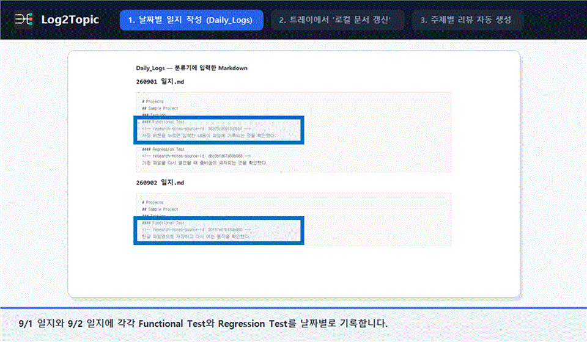
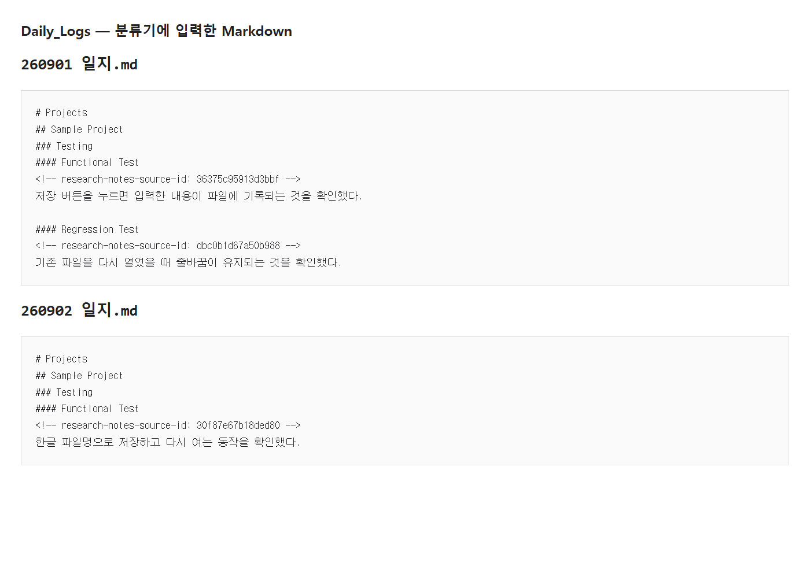
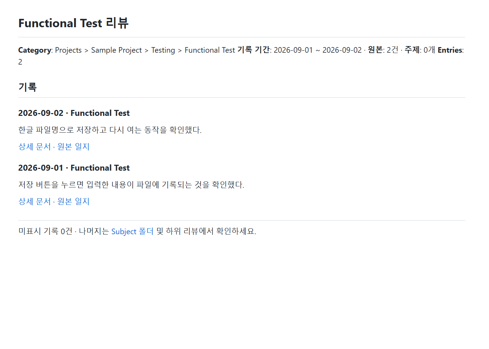
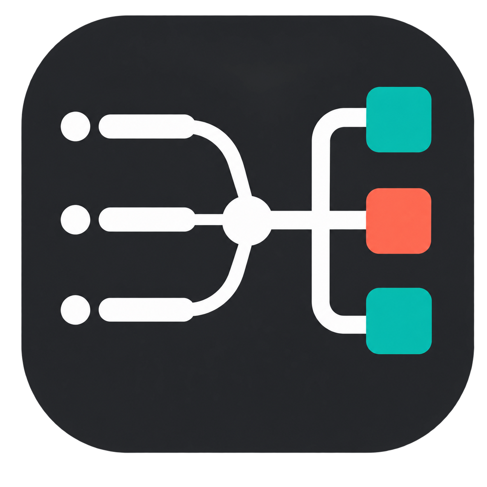
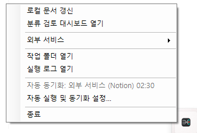
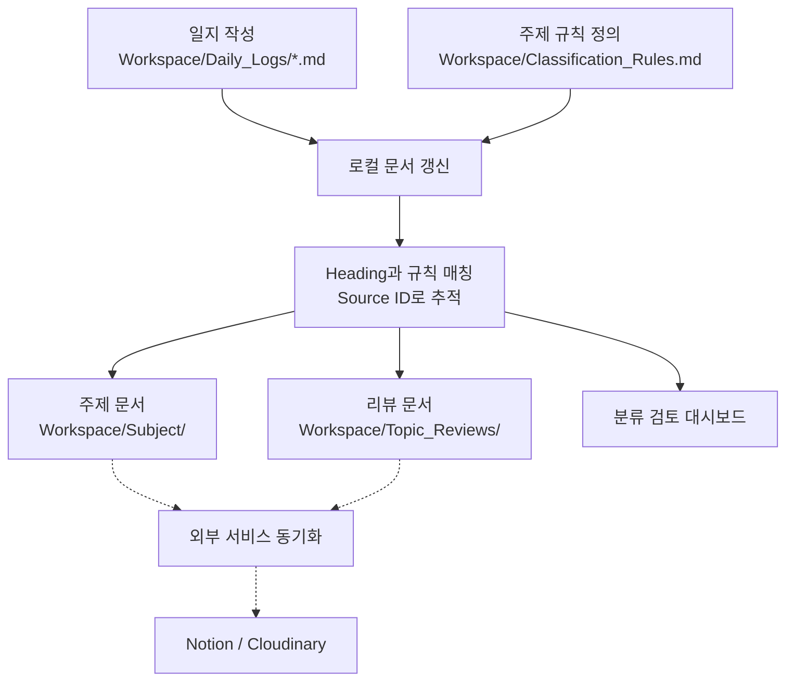

# Log2Topic

[English](README.md) · **한국어**

**날짜별로 쓰고, 주제별로 다시 읽는 Markdown 기록 도구**

하루의 일지에는 여러 주제의 작업이 섞이고, 하나의 주제는 여러 날짜에 걸쳐 이어집니다. 나중에 특정 주제의 기록을 확인하려면 여러 파일을 열고 필요한 내용을 다시 모아야 합니다.

Log2Topic은 **일지를 한 번 작성하면 주제별 문서와 날짜별 흐름을 보여주는 리뷰를 생성**합니다. 사용자가 정한 Heading과 분류 규칙으로 동작하며, AI나 외부 서비스 없이 로컬에서 사용할 수 있습니다.

[Before / After](#before--after) · [빠른 시작](#처음-시작하기) · [사용자 안내](docs/USER_GUIDE.md) · [분류 규칙](Workspace/Classification_Rules.md)

## 왜 만들었나

여러 연구·개발 과제를 동시에 진행하다 보면, 한 과제에 집중했다가 다른 과제로 넘어가고 몇 주 뒤 다시 돌아오는 일이 반복됩니다. 날짜별로 일지를 쓰는 것은 기록을 남기기에 가장 자연스럽지만, 시간이 지난 뒤 특정 과제로 복귀했을 때 **예전에 무엇을 시도했고, 어떤 문제가 있었으며, 왜 그런 결정을 내렸고 어디까지 진행했는지** 맥락을 되살리기는 어렵습니다. 관련 기록이 수주·수개월의 날짜별 파일 속에 흩어져 있기 때문입니다.

| 날짜별로 쌓인 일지 (`Daily_Logs/`) | 주제별로 복원된 맥락 (`Topic_Reviews/`) |
| :--- | :--- |
| **10/05** · 과제 A 초기 실험 → 과제 B 데이터 분석 → 회의 | **`[리뷰] 과제 A` 한 페이지**에서 연속해서 읽기 |
| **10/08** · 과제 C 기능 구현 → 과제 A 오류 원인 파악 및 수정 | · **10/15** — 수정안 적용 후 재실험 결과와 결론 |
| **10/15** · 과제 B 검증 테스트 → 과제 A 수정안 재실험 | · **10/08** — 발생한 오류 원인과 수정 과정<br>· **10/05** — 첫 실험 조건과 초기 결과 |

날짜별 일지가 *"그날 내가 무엇을 했는가"*를 남긴다면, 주제별 리뷰는 **"이 과제가 어떻게 여기까지 왔는가"**를 한 페이지에서 주르륵 내려 읽으며 작업 맥락을 복원해 줍니다.

그래서 **직접 쓴 날짜별 일지를 단일 작성처(Single Source of Truth)로 두고, 읽을 때만 주제별 흐름으로 재구성하는 도구**를 만들었습니다. Log2Topic은 작성한 문장이나 이미지를 임의로 요약·개작하지 않습니다. 대신 제목이나 분류 경로가 바뀌어도 같은 기록을 계속 추적할 수 있도록, **수정 전 원본을 `scripts/source_id_backups/`에 자동 백업한 뒤 각 구간의 Heading 아래에 렌더링 화면에는 보이지 않는 HTML 주석(`<!-- research-notes-source-id: ... -->`) 한 줄을 기록**하여 파생 문서들과 연결합니다(원본 파일을 전혀 수정하지 않는 완전 읽기 전용 모드가 필요하면 `--no-persist-source-ids` 옵션을 사용할 수 있습니다). 개인에게는 오랜만에 복귀한 과제의 맥락을 되찾는 도구가 되고, 선택적으로 Notion과 연동하면 팀원이 과제의 이전 실험·실패·결정 과정을 한눈에 파악하는 히스토리 문서가 됩니다.

## Before / After

**여러 날짜에 흩어진 기능 테스트 기록을, 하나의 리뷰에서 다시 읽습니다.**
일지를 저장하고 트레이에서 **로컬 문서 갱신**을 실행하면 됩니다.

<p align="center">
  
</p>

| Before · 날짜별로 작성 | After · 주제별로 확인 |
| :--- | :--- |
| **9/1 일지**에 기능 테스트와 회귀 테스트를 함께 기록 | **기능 테스트 상세 리뷰**에 9/2·9/1 기록을 최신순으로 표시 |
| **9/2 일지**에 기능 테스트를 이어서 기록 | **회귀 테스트**는 별도 리뷰와 주제 문서로 분류 |
| 같은 주제의 내용을 여러 일지에서 찾아야 함 | 리뷰의 발췌를 읽고 링크로 원본에 이동 |

<table>
<tr>
<th width="50%">Before · 입력한 일지</th>
<th width="50%">After · 생성된 리뷰</th>
</tr>
<tr>
<td valign="top"><a href="assets/readme-actual-before.png"></a></td>
<td valign="top"><a href="assets/readme-actual-after.png"></a></td>
</tr>
</table>

*이미지를 클릭하면 크게 볼 수 있습니다. 예시 일지 2개를 실제 분류기로 처리하고, 생성된 Level 4 「Functional Test」 상세 리뷰를 브라우저에서 캡처했습니다.*

작성·수정은 **`Daily_Logs/`**, 주제별 본문은 **`Subject/`**에서 확인합니다. **`Topic_Reviews/`**의 Level 1은 목차, Level 2는 최근 본문 최대 5건의 개요, Level 3~5는 원문 발췌를 읽는 상세 문서입니다. 미분류 리뷰는 원본 링크 목록으로 표시합니다. 생략된 기록은 하위 리뷰와 Subject 폴더에서 찾아볼 수 있습니다. 별도 요약문이나 체크박스 작성은 필요하지 않습니다.

## 처음 시작하기
다음 링크에서 다운로드가 가능합니다.
https://github.com/Rubidius37/Log2Topic/releases

아래 사진과 같이 최신 버전의 릴리즈를 다운로드 해주세요.


현재 배포본은 **Windows 10/11 x64** 및 **Linux(Python 3.10+)**를 지원합니다. Windows에서는 Python, Git, Notion 계정이 필요하지 않습니다. [Obsidian](https://obsidian.md/download)을 권장하지만 VS Code, Typora, MarkText 등 폴더 단위로 파일을 여는 다른 Markdown 편집기도 사용할 수 있습니다.

### 1. 프로젝트 폴더 준비

내려받은 프로젝트를 `문서\Log2Topic`처럼 파일을 수정할 수 있는 일반 폴더에 둡니다. 압축 파일 안이나 `Program Files`에서는 실행하지 마세요.

```text
Log2Topic/
├─ Log2Topic.exe
├─ Log2Topic.sh
├─ Workspace/                 # Markdown 편집기에서 이 폴더를 엽니다
│  ├─ Classification_Rules.md
│  ├─ Daily_Logs/
│  └─ attachments/
├─ scripts/
└─ runtime/
```

`Workspace/Daily_Logs/`와 `Workspace/attachments/`가 없으면 첫 실행 때 예시 일지 2개(`260901 일지.md`, `260902 일지.md`)와 함께 만들어지므로 곧바로 `로컬 문서 갱신`을 실행해 결과를 체험할 수 있습니다. `Workspace/Subject/`와 `Workspace/Topic_Reviews/`는 첫 분류 뒤 생성됩니다.

### 2. Markdown 작업공간 열기

Obsidian에서 **폴더를 Vault로 열기**를 선택하고 `Workspace/` 폴더를 지정합니다. 다른 Markdown 편집기에서도 같은 `Workspace/` 폴더를 작업공간으로 여세요. `Daily_Logs/`만 따로 열면 생성 문서의 상대 링크가 올바르게 연결되지 않습니다.

> **기존에 쓰던 Obsidian Vault를 그대로 연결하거나 초보자용 규칙으로 시작하려면**: 트레이 메뉴의 `자동 실행 및 동기화 설정...` 창에서 **`작업공간 / Vault`의 `[찾아보기...]` 버튼**으로 기존 Vault 폴더를 직접 선택할 수 있고, **`분류 규칙 템플릿`**에서 **「단순 과제형 1~2단계 (초보자 권장)」**·**「연구·실험 노트형 (3단계)」**·**「소프트웨어 개발·QA형 (3~4단계)」** 중 하나를 골라 바로 시작할 수 있습니다. (환경변수 `LOG2TOPIC_WORKSPACE`로도 지정 가능)

### 3. Log2Topic 실행

1. Windows에서는 `Log2Topic.exe`를 더블클릭합니다. Linux·macOS에서는 `./Log2Topic.sh tray`(트레이 아이콘 또는 데스크톱 컨트롤 창) 또는 `./Log2Topic.sh`(터미널 메뉴)를 실행합니다.
2. 최초 설정에서 자동 작업은 `사용 안 함`으로 저장해도 됩니다.
3. 작업표시줄 알림 영역의 Log2Topic 아이콘을 찾습니다. 보이지 않으면 `^`를 눌러 숨겨진 아이콘을 확인합니다. (Linux·macOS에서 시스템 트레이 아이콘을 사용하려면 선택적으로 `pip install pystray pillow`를 설치하며, 미설치 시에는 내장 `tkinter` 기반 데스크톱 컨트롤·설정 창이 열립니다.)

알림 영역에서 찾아야 할 **Log2Topic 트레이 아이콘**은 다음과 같습니다.



이 아이콘을 우클릭하면 다음과 같은 메뉴가 표시됩니다.



메뉴와 설정 화면은 기본적으로 시스템 표시 언어를 따릅니다. `자동 실행 및 동기화 설정...`의 언어 항목에서 `System default`, `English`, `한국어` 중 하나를 선택할 수 있으며, 변경한 언어는 Log2Topic을 다시 실행하면 적용됩니다.

Windows 배포본에는 전용 Python 실행 환경이 포함되어 있어 Python 설치나 PATH 설정은 필요하지 않습니다. 실행 파일은 아직 디지털 서명되지 않았으므로 Windows 경고가 나오면 파일 이름과 내려받은 위치를 확인한 뒤 실행 여부를 결정하세요.

> **소스에서 직접 빌드 또는 EXE 없이 실행하기**: `Log2Topic.exe`는 단일 C# 소스 파일(`app/Log2Topic.cs`)을 Windows 기본 .NET 컴파일러로 빌드한 것입니다. 바이너리를 직접 검증하고 싶다면 `Log2Topic.exe`를 삭제한 뒤 `.\scripts\build_windows_app.ps1 -SkipRuntimeDownload`로 1초 만에 직접 다시 빌드하거나, `.exe` 없이 `.\scripts\run_local.bat` 및 `.\Log2Topic.bat`(PowerShell 트레이)으로 모든 기능을 그대로 실행할 수 있습니다.

### 4. 첫 분류 규칙과 일지 작성

`Workspace/Classification_Rules.md`의 표에 주제 경로를 작성합니다. 표의 여섯 열과 순서는 유지하고, Level 1부터 Level 5를 일지의 `#`부터 `#####` Heading과 맞춥니다. Heading이 분류명과 같으면 매칭 키워드는 비워도 됩니다.

`Workspace/Daily_Logs/`에 `.md` 파일을 만들고 분류 규칙과 같은 이름의 Heading을 작성합니다. 자세한 작성 방법은 [사용자 안내](docs/USER_GUIDE.md)를 참고하세요.

리뷰에 일지 날짜를 표시하고 최근 5건을 날짜순으로 보려면 **파일명 앞에 날짜를 적어 `.md`로 저장하세요**. 예를 들어 `26.09.27 일지.md`, `260927 일지.md`, `2026-09-27-log.md`를 인식합니다. 날짜 표기는 권장 사항이며 필수는 아닙니다. 날짜가 없는 `.md` 파일도 분류하지만 리뷰에는 `날짜 없음`으로 표시되고 날짜가 있는 기록 뒤에 놓입니다. 파일 수정일은 사용하지 않으므로 나중에 일지를 편집해도 기록 날짜가 바뀌지 않습니다. 확장자가 없는 파일은 분류하지 않습니다.

### 5. 첫 결과 확인

1. 트레이의 Log2Topic 아이콘을 우클릭합니다 (Linux는 `./Log2Topic.sh update`).
2. `로컬 문서 갱신`을 선택합니다.
3. 생성 문서의 `Date/Log` 링크로 원본 일지가 열리는지 확인합니다.

여기까지 성공하면 기본 기능을 사용할 준비가 끝난 것입니다. Obsidian 첨부파일 위치, 검토 대시보드와 자동 실행 설정은 [사용자 안내](docs/USER_GUIDE.md)에서 이어서 확인할 수 있습니다.

## 핵심 특징

- **로컬 우선**: 외부 전송 없이 내 컴퓨터에서 분류와 검토
- **단일 작성처 (Single Source of Truth)**: `Workspace/Daily_Logs/` 한 곳만 직접 작성·수정하고 주제 문서와 리뷰는 자동 생성
- **계층형 분류**: Markdown Heading을 Level 1부터 Level 5까지의 주제 경로로 변환
- **규칙 기반 처리**: AI 분류 없이 동일한 원본과 규칙에 재현 가능한 결과
- **Source ID 주석 추적 (자동 백업 포함)**: 원본 Heading 아래에 비표시 HTML 주석(`<!-- research-notes-source-id -->`)을 기록해 제목이나 경로가 바뀌어도 파생 문서와 연결 유지 (수정 전 원본 자동 백업, `--no-persist-source-ids`로 읽기 전용 실행 가능)
- **표준 Markdown**: Obsidian, VS Code와 일반 Markdown 편집기에서 사용 가능
- **선택적 연동**: 로컬 기능은 독립적으로 유지하고 Notion과 Cloudinary는 필요할 때만 연결

## 기존 도구와의 차이점

| 도구 / 방식 | 주된 접근 방식 | Log2Topic과의 차이점 |
| :--- | :--- | :--- |
| **Obsidian Dataview / Bases** | 프론트매터·태그 기반 동적 목록/표 조회 | 파일 목록만 보여주는 대신, **일지 내부의 특정 구간 본문과 이미지를 추출해 한 페이지로 읽히는 정적 Markdown 리뷰 파일을 생성** (플러그인 없이 VS Code·GitHub·Notion 어디서나 열람 가능) |
| **Logseq** | 아웃라이너 블록 참조와 저널 쿼리 | 전용 아웃라이너 문법에 종속되지 않고 **일반 장문 Markdown(표, 코드 블록, 이미지) 파일 구조 그대로 동작** |
| **Note Refactor / 수동 분리** | 일지의 일부를 별도 노트 파일로 수동 추출 | 문서를 쪼개며 원본 맥락을 훼손하지 않고, **날짜별 일지를 그대로 둔 채 제목·경로 변경 시에도 `Source ID`로 파생 문서를 자동 재컴파일** |

## 대규모 코퍼스 검증 및 성능 지표

단순 한 줄짜리 더미가 아닌, **구간(Chunk)당 약 3,600바이트의 복합 엔지니어링 로그**(실험 서술 문단, 하위 소제목, 일반/장문 코드 블록, 측정 결과 표, 중첩 콜아웃, 첨부 이미지 2개 포함)로 구성된 **1,000개 일지 코퍼스**를 대상으로 검증한 실측 지표입니다 (`python scripts/benchmark_large_corpus.py --files 1000`으로 직접 재현 가능).

| 검증 항목 | 테스트 규모 및 조건 | 측정 결과 |
| :--- | :--- | :--- |
| **테스트 코퍼스 규모** | 일지 **1,000개** · 구간 **3,500개** (구간당 ~3.6 KB) | 원본 Markdown **12.04 MB** (**180,287줄**) → 생성 문서 **5,309개 (22.72 MB)** |
| **최초 전체 컴파일 (Cold Run)** | 3,500개 `Source ID` 신규 발급 + 원본 1,000개 백업 + `Subject/`(5,287개)·`Topic_Reviews/`(22개) 전체 생성 | **약 48.1초** (초당 **73개** 장문 구간 처리, Windows NTFS 기준) |
| **재실행 속도 및 결정론 (Warm Run)** | 변경 없는 상태에서 재컴파일 + 5,309개 생성 파일 전체 SHA-256 대조 | **약 26.7초** (초당 **131개** 구간 처리) · **SHA-256 100% 바이트 단위 일치** |
| **대규모 제목 리팩터링 추적** | 100개 일지 구간의 분류 Heading을 다른 주제로 일괄 변경 후 재실행 | **3,500 / 3,500개 `Source ID` 100% 보존** · 이전 경로 고아(Orphan) 파일 **0개** |

## 동작 흐름

실선은 기본 로컬 동작이고, 점선은 사용자가 설정한 외부 연동입니다.



생성된 문서는 직접 고치지 않습니다. 원본 일지나 분류 규칙을 수정한 뒤 다시 갱신하면 Source ID를 기준으로 기존 결과가 정리됩니다.

## 선택 사항: 외부 서비스

로컬 분류만 사용할 때는 외부 서비스 설정이 필요하지 않습니다.

### Notion

Notion 데이터베이스로 일지, 주제 문서와 리뷰를 동기화할 수 있습니다. 내부 연결, `Sync Key`, Cloudinary 이미지와 오류 복구 설정은 [Notion 연동 안내](docs/NOTION_INTEGRATION.md)를 순서대로 따라가세요. 하나의 Notion 데이터베이스에는 하나의 기준 Markdown 작업공간만 연결하는 것을 권장합니다.

인라인 `data:` 이미지도 크기·형식·정적 SVG 보안 검사를 거쳐 업로드합니다. 지원하지 않는 인라인 이미지는 생략 안내를 남기고 본문 동기화를 계속합니다. (Notion 서버가 이미지를 읽을 수 있도록 Cloudinary 업로드 이미지는 공개 URL로 생성되므로, 외부 노출에 민감한 기밀 이미지는 로컬 전용 모드로만 사용하세요.) 자세한 지원 범위는 [인라인 이미지 안내](docs/NOTION_INTEGRATION.md#인라인-data-url-이미지)를 확인하세요.

## 지원 환경

- 공식 지원: Windows 10/11 x64 (`Log2Topic.exe`), Linux 및 macOS (`./Log2Topic.sh` 또는 `python3 log2topic.py`, Python 3.10+)
- 권장 편집기: Obsidian 데스크톱, VS Code, Typora, MarkText 등 폴더와 표준 Markdown 상대 링크를 지원하는 편집기
- 인터넷 없이 사용 가능: 로컬 분류와 검토 대시보드
- **실행 파일 자체 빌드 및 순수 Python 실행 지원**: `Log2Topic.exe`는 단일 소스 파일([`app/Log2Topic.cs`](app/Log2Topic.cs))에서 빌드됩니다. 서명되지 않은 미리 빌드된 EXE 실행을 원치 않으시면 `Log2Topic.exe`를 삭제한 뒤 Windows 기본 `.NET` 컴파일러로 직접 빌드(`.\scripts\build_windows_app.ps1 -SkipRuntimeDownload`)하거나, 순수 Python 진입점(`python log2topic.py update`)으로 모든 기능을 동일하게 실행할 수 있습니다. 원본 일지에 `<!-- research-notes-source-id -->` 주석을 기록하지 않으려면 `--no-persist-source-ids` 옵션을 사용하세요.

## 문제가 생겼을 때

- 트레이 아이콘이 없으면 숨겨진 아이콘과 `scripts/.runtime/app_error.log`를 확인합니다.
- 일지를 찾지 못하면 `Workspace/Daily_Logs/` 아래의 파일 확장자가 `.md`인지 확인합니다.
- `[BUSY]`가 나오면 진행 중인 분류나 동기화가 끝난 뒤 다시 실행합니다.
- Notion 오류는 `scripts/reports/notion_sync_report.md`에서 확인합니다.
- Source ID 저장 실패와 업데이트 확인 실패는 [오류별 점검 안내](docs/TROUBLESHOOTING.md)를 참고하세요.

더 많은 점검 순서는 [사용자 안내의 문제 해결](docs/USER_GUIDE.md#문제-해결)을 참고하세요.

## 피드백과 문제 제보

버그와 기능 제안은 이 저장소의 GitHub `Issues` 탭에 남겨주세요. 공개 Issue에는 **연구자료와 인증정보**를 첨부하지 말고, 실제 내용 대신 재현 가능한 가상 예제를 사용하세요. 자세한 작성 기준은 [사용자 안내](docs/USER_GUIDE.md#피드백과-문제-제보)에 있습니다.

## 문서

- [사용자 안내](docs/USER_GUIDE.md): Obsidian 설정, 일상 사용, 검토, 자동 실행과 문제 해결
- [분류 규칙](Workspace/Classification_Rules.md): Level 계층, 상속형 표, 키워드와 경계 규칙
- [Notion 연동](docs/NOTION_INTEGRATION.md): 데이터베이스 연결, 이미지와 동기화 복구
- [시스템 구조](docs/SYSTEM_REFERENCE.md): Source ID, 내부 상태와 유지보수 기준

## 라이선스

이 프로젝트는 [GNU General Public License v3.0 (GPL-3.0)](LICENSE)로 배포됩니다.
