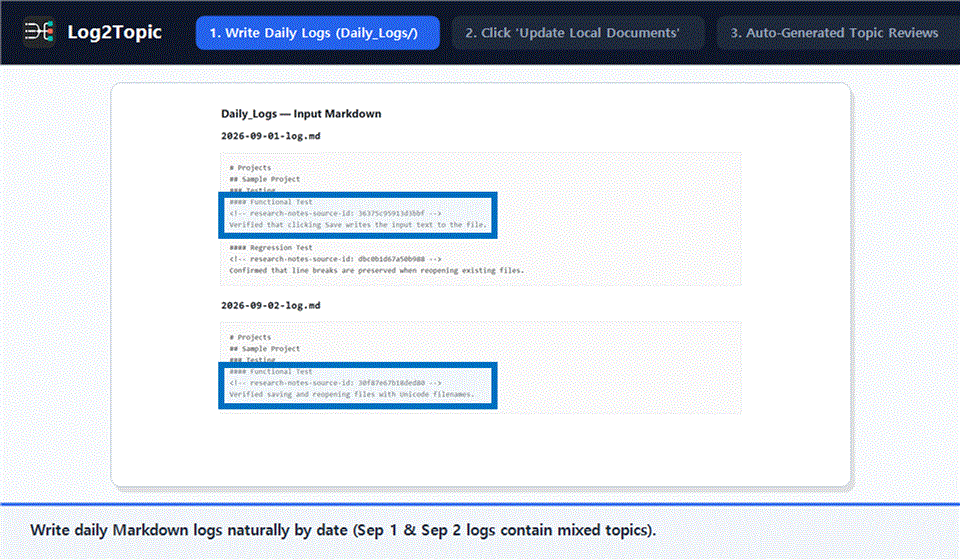
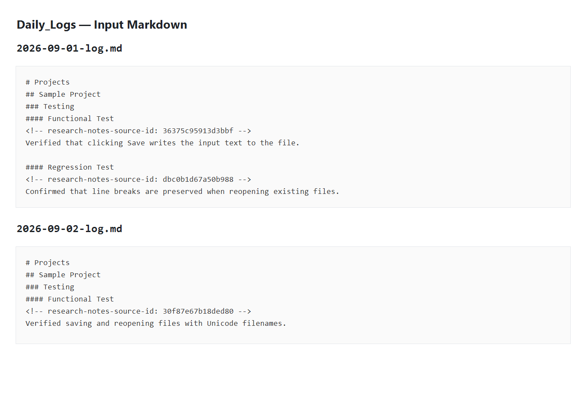
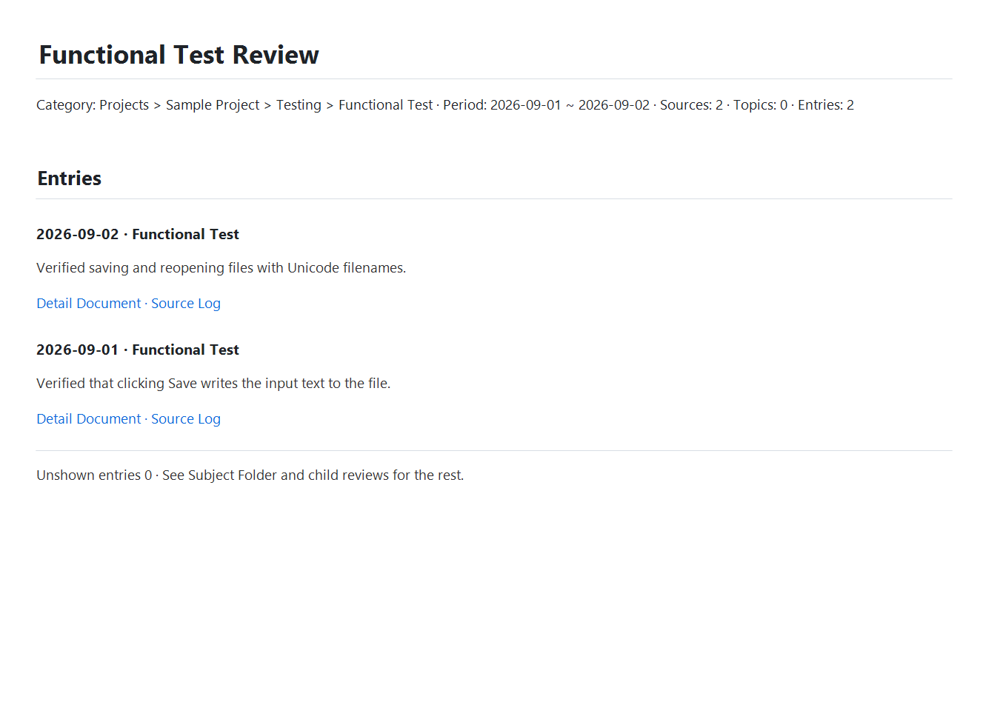
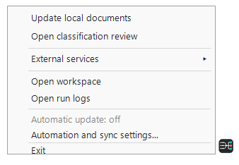
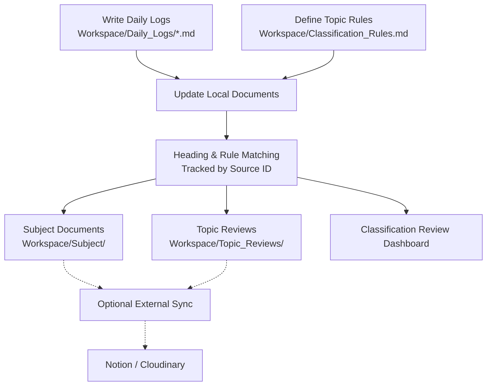

# Log2Topic

**English** · [한국어](README.ko.md)

**Write by Date, Read by Topic — A Local-First Markdown Research & Engineering Log Compiler**

In daily work or research logs, a single day's note mixes multiple topics, while a single topic spans across many days. When you later need to review the history of one topic, you have to open dozens of daily files and piece the story back together—or manually copy notes into topic folders and risk duplicates drifting out of sync.

**Log2Topic** lets you **write your daily logs once in `Daily_Logs/` and automatically compiles topic documents (`Subject/`) and chronological topic reviews (`Topic_Reviews/`)**. It runs 100% locally using deterministic Markdown heading and rule matching—with no external API or cloud required.

[Before / After](#before--after) · [Quick Start](#quick-start) · [User Guide](docs/USER_GUIDE.md) · [Classification Rules](Workspace/Classification_Rules.md)

## Why Log2Topic?

When juggling multiple research or engineering projects, you constantly switch contexts—focusing on Project A, moving to Project B and C, and returning to Project A weeks later. Writing notes by date is the most natural way to log daily work, but when you return to a project after weeks away, it is hard to reconstruct **what you tried, what failed, why you made certain decisions, and where you left off** because those records are scattered across dozens of daily files.

| Scattered Daily Logs (`Daily_Logs/`) | Reconstructed Topic Context (`Topic_Reviews/`) |
| :--- | :--- |
| **Oct 05** · Project A initial test → Project B analysis → Meeting | **Read `Project A` end-to-end on a single page** |
| **Oct 08** · Project C implementation → Project A bug root-cause & fix | · **Oct 15** — Re-test results and conclusion after fix |
| **Oct 15** · Project B validation → Project A re-test after fix | · **Oct 08** — Failure root-cause and fix process<br>· **Oct 05** — Initial test conditions and baseline results |

Daily logs answer *"What did I do that day?"*, while Topic Reviews answer **"How did this project get to where it is today?"**—letting you scroll through a single page to restore your full working context.

Log2Topic treats your **daily Markdown logs as the Single Source of Truth**—you only ever write and edit in `Daily_Logs/`. Instead of summarizing or altering your prose with AI, it deterministically compiles your exact notes and images into topic-specific documents and reverse-chronological reviews. To track each section across heading renames or category moves, it **automatically backs up the file under `scripts/source_id_backups/` and inserts a single invisible HTML comment (`<!-- research-notes-source-id: ... -->`) below each section heading** (or `Category:` when you assign a manual override in the dashboard). If you prefer strictly read-only classification that never modifies files in `Daily_Logs/`, pass `--no-persist-source-ids`. For individuals, it restores context when returning to a task; when optionally synced to Notion, it gives teammates a complete, readable history of past experiments, failures, and decisions.

## Before / After

**Read scattered `Functional Test` records from multiple dates in a single compiled review.**
Just save your daily log and click **Update local documents** from the system tray (or run `./Log2Topic.sh update` on Linux).

<p align="center">
  
</p>

| Before · Write by Date (`Daily_Logs/`) | After · Read by Topic (`Topic_Reviews/`) |
| :--- | :--- |
| **Sep 1 log** records both `Functional Test` and `Regression Test` | **Functional Test Review** compiles Sep 2 & Sep 1 entries in newest-first order |
| **Sep 2 log** continues `Functional Test` work | **Regression Test** is separated into its own topic document and review |
| You had to search across multiple daily files | Read excerpts in one place and jump to the source log via relative links |

<table>
<tr>
<th width="50%">Before · Input Daily Logs</th>
<th width="50%">After · Generated Topic Review</th>
</tr>
<tr>
<td valign="top"><a href="assets/readme-actual-before-en.png"></a></td>
<td valign="top"><a href="assets/readme-actual-after-en.png"></a></td>
</tr>
</table>

*Click either image to enlarge. Captured from the actual classifier output for the two sample logs.*

Write and edit only in **`Daily_Logs/`**. Full per-entry topic notes are generated in **`Subject/`**, and multi-level reading documents are generated in **`Topic_Reviews/`** (Level 1: topic index, Level 2: recent overview of up to 5 entries, Level 3–5: detailed excerpts). Ambiguous or unclassified sections can be assigned in the local **Classification Review Dashboard** (`http://127.0.0.1:8000`).

## Quick Start

Download the latest release from GitHub Releases:
https://github.com/Rubidius37/Log2Topic/releases

- **Windows 10/11 x64**: Includes a bundled embedded Python runtime and native system tray app (`Log2Topic.exe`). No Python, Git, or Notion account is required.
- **Linux**: Uses `./Log2Topic.sh` with Python 3.10+ (zero external pip packages required).
- **Markdown Editors**: Works with [Obsidian](https://obsidian.md/download), VS Code, Typora, MarkText, Zettlr, Joplin, or any editor that opens a folder and supports standard relative Markdown links.

### 1. Prepare the Project Folder

Extract the release into a writable folder (such as `Documents\Log2Topic` or `~/Log2Topic`). Do not run it inside a ZIP archive or `Program Files`.

```text
Log2Topic/
├─ Log2Topic.exe              # Windows system tray app
├─ Log2Topic.sh               # Linux CLI & interactive menu launcher
├─ Workspace/                 # Open THIS folder in your Markdown editor
│  ├─ Classification_Rules.md
│  ├─ Daily_Logs/
│  └─ attachments/
├─ scripts/
└─ runtime/
```

On your first run, `Workspace/Daily_Logs/` is automatically seeded with two sample logs (`2026-09-01` and `2026-09-02`) matching `Workspace/Classification_Rules.md`, so you can test classification immediately. `Workspace/Subject/` and `Workspace/Topic_Reviews/` are created after the first update.

### 2. Open `Workspace/` in Your Markdown Editor

In Obsidian, choose **Open folder as vault** and select the `Workspace/` directory. In VS Code, Typora, or MarkText, open `Workspace/` as your project folder. (Opening only `Daily_Logs/` will prevent relative links to `Subject/` and `Topic_Reviews/` from resolving.)

> **Using an Existing Obsidian Vault or Beginner Rule Templates**: Open `Automation and sync settings...` from the tray menu (or `./Log2Topic.sh gui`) and click **`Browse...`** next to **`Workspace / Vault`** to point Log2Topic at your existing vault folder without moving any files. You can also select a starter **`Rule template`**—**Simple 1–2 level (Beginner recommended)**, **Research & experiment notes (3-level)**, or **Software & QA engineering (4-level)**—to start classifying immediately without designing a 5-level table from scratch.

### 3. Run Log2Topic

- **Windows**:
  1. Double-click `Log2Topic.exe`.
  2. In the initial settings dialog, you can leave scheduled tasks set to `Off` and click Save.
  3. Find the Log2Topic icon in the Windows system tray and right-click it:




  The tray UI and review dashboard automatically follow your OS display language, or you can explicitly select `System default`, `English`, or `한국어` under `Automation and sync settings...`.

  > **Verify or Build from Source (No Unsigned Binary Required)**: `Log2Topic.exe` is compiled from a single C# source file (`app/Log2Topic.cs`) using the built-in Windows .NET Framework compiler. You can delete `Log2Topic.exe` and rebuild it yourself in 1 second with `.\scripts\build_windows_app.ps1 -SkipRuntimeDownload`, or run the batch/PowerShell scripts directly (`.\scripts\run_local.bat`, `.\Log2Topic.bat`) without any `.exe`.

- **Linux & macOS**:
  ```bash
  ./Log2Topic.sh tray      # Launch system tray icon (with optional pystray/pillow) or desktop GUI
  ./Log2Topic.sh gui       # Open the desktop controller & automation settings window (tkinter)
  ./Log2Topic.sh update    # Update local Subject/ and Topic_Reviews/
  ./Log2Topic.sh review    # Open the local classification review dashboard
  ./Log2Topic.sh           # Open the interactive terminal menu
  ```

### 4. Define Rules and Write Daily Logs

1. Edit the 5-level inherited table in `Workspace/Classification_Rules.md` (`Level 1` to `Level 5` correspond to `#` through `#####` headings in your daily logs).
2. Create `.md` files in `Workspace/Daily_Logs/` using matching headings.
3. Prefix filenames with a date (e.g., `2026-09-27-log.md`, `26.09.27.md`, `260927.md`) so reviews sort and display dates accurately.

### 5. Verify Your First Output

1. Click **Update local documents** in the tray menu, or run `./Log2Topic.sh update`.
2. Open the generated files in `Workspace/Subject/` and `Workspace/Topic_Reviews/` and follow the `Date/Log` relative link back to your source log.

## Key Features

- **100% Local-First**: Classify and review notes on your machine with no external API or cloud transmission
- **Single Source of Truth**: Write and edit only in `Workspace/Daily_Logs/`; topic notes and reviews are compiled automatically
- **5-Level Hierarchical Classification**: Maps Markdown `#`–`#####` headings and optional keywords to structured topic trees
- **Deterministic & Reproducible**: Rule-based compiler produces identical outputs for identical inputs
- **Permanent Source ID Tracking (with Automatic Backups)**: Inserts a lightweight HTML comment (`<!-- research-notes-source-id -->`) below each heading (after backing up the original under `scripts/source_id_backups/`) to track sections across heading renames, merges, and category changes—or run strictly read-only with `--no-persist-source-ids`
- **Universal Markdown Compatibility**: Standard relative links, CommonMark link/image titles, parenthesized paths, and per-document asset folders work across Obsidian, VS Code, Typora, and GitHub
- **Optional External Sync**: Sync daily logs, subject notes, and topic reviews to **Notion** (with **Cloudinary** image caching and static SVG security validation) only when needed

## How It Compares

| Tool / Approach | Primary Mechanism | How Log2Topic Differs |
| :--- | :--- | :--- |
| **Obsidian Dataview / Bases** | Dynamic metadata queries and table views | Instead of listing links, Log2Topic **extracts section bodies, tables, code blocks, and images from inside daily logs into standalone static Markdown reviews** readable anywhere (VS Code, GitHub, Notion) without running a plugin |
| **Logseq** | Outliner journal blocks and block references | Works with **standard long-form Markdown files** (headings, tables, fenced code, images) without locking notes into an outliner bullet hierarchy |
| **Note Refactor / Manual Splitting** | Manually extracting sections into separate files | Keeps your **daily logs intact** and automatically recompiles derived topic files via `Source ID` whenever headings or category rules change |

## Large-Corpus Verification & Benchmark

Verified against a realistic **1,000-file engineering log corpus** where every section is a **~3,600-byte multi-block record** containing narrative prose, subheadings, short and long (>650 chars) code blocks, measurement tables (>900 chars), nested callouts, and 2 embedded images (`python scripts/benchmark_large_corpus.py --files 1000`).

| Verification Metric | Corpus Scale & Workload | Measured Result |
| :--- | :--- | :--- |
| **Input & Output Volume** | **1,000** daily logs · **3,500** heavy sections (~3.6 KB/section) | **12.04 MB** (**180,287 lines**) input → **5,309 generated files (22.72 MB)** |
| **Initial Full Compile (Cold Run)** | Assign 3,500 new `Source ID`s + back up 1,000 source files + compile 5,287 `Subject/` & 22 `Topic_Reviews/` files | **~48.1 s** (**73 heavy sections/s** on Windows NTFS) |
| **Idempotent Re-compile & Determinism (Warm Run)** | Re-run on unchanged corpus + verify SHA-256 across all 5,309 generated files | **~26.7 s** (**131 sections/s**) · **100% byte-for-byte SHA-256 match** |
| **Large-Scale Heading Refactoring** | Move 100 sections across categories by renaming headings in 100 files | **3,500 / 3,500 `Source ID`s preserved (100%)** · **0 orphan files** left behind |

## Workflow Architecture

Solid lines represent the default local workflow; dashed lines represent optional external synchronization.



## Optional: External Services

### Notion

You can synchronize daily logs, subject documents, and topic reviews to a Notion database while preserving page IDs and internal links via `Sync Key`. Bounded inline `data:` images are also validated and uploaded through the content-addressed Cloudinary cache. Note that images uploaded via Cloudinary unsigned presets use public URLs so Notion's servers can fetch them; keep confidential images in local-only mode. See the [Notion Integration Guide](docs/NOTION_INTEGRATION.md) for setup and recovery instructions.

## Supported Environments

- **Supported OS**: Windows 10/11 x64 (`Log2Topic.exe`), Linux & macOS (`./Log2Topic.sh` or `python3 log2topic.py`, Python 3.10+)
- **Recommended Editors**: Obsidian Desktop, VS Code, Typora, MarkText, or any folder-based Markdown editor
- **Offline Ready**: Local classification and the review dashboard work completely offline
- **Verifiable & Auditable Execution**: On Windows, `Log2Topic.exe` is compiled directly from [`app/Log2Topic.cs`](app/Log2Topic.cs). If you prefer not to run a pre-built executable, you can delete `Log2Topic.exe` and either recompile it locally in 1 second using Windows' built-in `.NET` compiler (`.\scripts\build_windows_app.ps1 -SkipRuntimeDownload`) or run the pure-Python CLI (`python log2topic.py update`) directly. To classify without writing `<!-- research-notes-source-id -->` comments into `Daily_Logs/`, pass `--no-persist-source-ids`.

## Troubleshooting

- If the tray icon is not visible on Windows, check the hidden tray overflow (`^`) and `scripts/.runtime/app_error.log`.
- If logs are not classified, verify that files under `Workspace/Daily_Logs/` use the `.md` extension.
- If `[BUSY]` appears, wait for the active classification or sync process to finish.
- For Notion sync issues, check `scripts/reports/notion_sync_report.md` and [Troubleshooting](docs/TROUBLESHOOTING.md).

## Feedback & Issues

Please report bugs or feature requests in the GitHub `Issues` tab. Do **not** attach private research notes or API credentials (`.env`) to public issues—use minimal fictional examples instead. See [User Guide](docs/USER_GUIDE.md) for details.

## Documentation

- [Korean README (한국어 소개)](README.ko.md)
- [User Guide](docs/USER_GUIDE.md): Editor setup, daily workflow, review dashboard, and automation
- [Classification Rules](Workspace/Classification_Rules.md): 5-level hierarchy, inherited table syntax, and keyword boundaries
- [Notion Integration](docs/NOTION_INTEGRATION.md): Database setup, image caching, and recovery
- [System Reference](docs/SYSTEM_REFERENCE.md): Source ID lifecycle, atomic state, process locking, and architecture

## License

This project is licensed under the [GNU General Public License v3.0 (GPL-3.0)](LICENSE).
